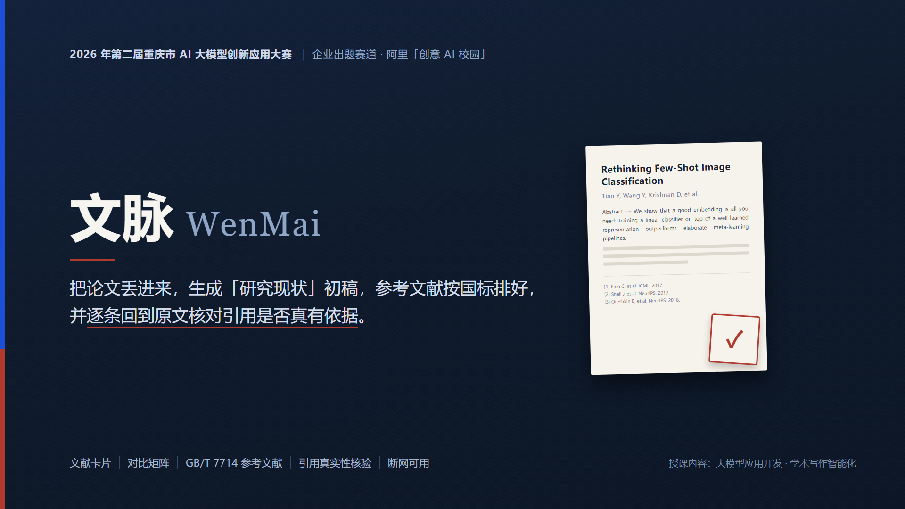

<p align="center">
  
</p>

<h1 align="center">文脉 WenMai</h1>
<p align="center"><em>文献综述写作与引用自检助手 —— 帮你把引用和格式做对，而不是替你写论文</em></p>

<p align="center">
  
  
  
  
  
  
</p>

<p align="center">
  2026 年第二届重庆市 AI 大模型创新应用大赛 · 企业出题赛道（阿里「创意 AI 校园」）<br/>
  赛题归类：科研创新 —— 文献综述助手　｜　技术路径：RAG + 微调，并入 Agent 能力
</p>

---

## 📖 它解决什么问题

写毕业论文、做科研训练、跟导师做课题的本科生，手上通常有 30–50 篇 PDF：读完要两三周，
读完还要面对最烦的一件事——**参考文献格式（GB/T 7714）和引用编号，错一处就要返工**。

现有工具帮你"读懂"，但**不帮你"交得出去"**。

文脉只做两件事，但都做到能直接交付：

1. **把出口做实用**——输出可直接使用的 Word 稿件，参考文献自动按 GB/T 7714 排好；
2. **把可信度做硬**——生成之后**自动自检**：引用是否真实、编号顺序对不对、格式合不合规、有没有该引没引。

关键在于：**引用是否成立，你可以点开每条结论，自己看它检索到的原文片段与页码再判断。**

---

## ✅ 三条设计承诺（均已实测）

| 承诺 | 实现方式 | 实测结果 |
|---|---|---|
| **单命令启动** | 一次 `demo` 自动查依赖、按需生成、跑全流程、开本地页面 | 全流程 **27.1 秒**（云端通道 + 内容已缓存，6 篇文献）；首次或离线全流程约 **127 秒** |
| **断网也能演示** | 本地引擎为主（随包 Qwen2.5-3B + bge-small-zh + BM25），百炼 API 仅作增强层 | 实测 `WM_OFFLINE=1` 下全流程正常，正文、自检、导出全部可用 |
| **零登录** | 演示路径不依赖任何需要登录的云控制台 | 全流程无登录步骤 |

> **一次真实的自动降级**：某次运行中 DNS 解析失败（`getaddrinfo failed`），程序按设计自动切到本地通道并完成全流程，演示未中断。

---

## 🔄 它怎么工作

```
① 导入文献（本地 PDF，或 OpenAlex 开放获取论文）
        ↓
② 解析：全文 / 摘要 / 章节 / 参考文献区 / 局限句 / 贡献句
        ↓
③ 文献卡片：解决什么问题 / 方法 / 数据 / 指标 / 局限 / 可借鉴点
        ↓
④ 主题聚类 + 对比矩阵（可导出 Excel）
        ↓
⑤ 起草综述：正文带 [n] 引用角标，编号由程序统一分配
        ↓
⑥ 引用自检（10 项）+ 埋错测试
        ↓
⑦ 导出 Word（正文 + GB/T 7714 参考文献 + 自检报告）
```

### 关键设计取舍

- **引用编号由程序分配，不交给模型自由编号。** 生成后按正文首次出现顺序重排（顺序编码制），并剔除未被引用的条目——保证「正文角标 ↔ 文末条目」严格一一对应。
- **RAG 检索是真正的 R。** 每篇论文全文切成语义完整段落建索引；正文每一处引用都会回到对应论文原文检索证据，再由模型判断该论断是否成立。检索用阿里云百炼 `text-embedding-v3` 语义向量，断网时退回本地字符 n-gram。
- **Agent 审稿。** 模型自主决定调用哪些工具（读全稿 → 挑可疑项 → 回原文核对 → 出报告），不是固定顺序跑一遍。
- **双通道容错。** 本地通道（规则 + BM25 + 哈希向量）始终可用、零成本；模型通道有网络时自动增强。任一步失败都不中断流程。

---

## 🔍 引用自检的 10 项检查

| # | 检查项 | 说明 |
|---|---|---|
| 1 | 引用真实性 | 正文角标 `[n]` 在参考文献表中是否存在 |
| 2 | 文末未引用 | 文末条目是否在正文中从未出现 |
| 3 | 编号顺序 | 角标是否按首次出现顺序递增（顺序编码制） |
| 4 | 格式合规 | 逐条对照 GB/T 7714（作者 / 题名 / 类型标识 / 出版项 / 年份 / 访问路径） |
| 5 | 重复著录 | 同一文献被著录两次、编号重复 |
| 6 | 论断有据 | 回原文检索后，那句话在对应论文里找不到支撑 |
| 7 | 引用越界 | 编号超出参考文献表范围 |
| 8 | 原文明确矛盾 | 正文数值或方向与原文冲突（如正文写「提升 10 倍」而原文是 2 倍） |
| 9 | 原文缺失（无法核对） | 该文献原文不在库里——**这不是引用写错** |
| 10 | 该引未引 | 像研究结论却没有任何引用标注的陈述 |

除第 6、10 项外都是**确定性规则，不依赖模型**，因此断网时依然全部有效（第 10 项依赖语义检索，界面标注「仅供参考」）。

### 回原文核对：四态判定

「论断有据」会回到被引论文原文检索证据，给出四种结论。分开报是刻意的——把「没找到依据」和「原文说的正好相反」混成一个标签，用户就分不清"你去核对一下"和"你写错了"：

| 结论 | 含义 | 该怎么处理 |
|---|---|---|
| **有依据** | 原文片段确实讲到该句的核心内容 | 无需处理 |
| **找不到依据** | 检索到段落，但它讲的是别的事 | 不等于引用写错，点开原文片段自行判断 |
| **原文明确矛盾** | 正文的数值或方向与原文冲突 | 硬结论：以原文为准修改，或更换引用 |
| **无法核对** | 该文献原文不在库里 | 不是引用问题，把原文导进来即可核对 |

「原文明确矛盾」由**确定性比对**判定（同量纲数值不一致、论断数值在原文中不存在、方向相反），刻意保守——**宁可漏报，也不把"没找到"说成"写错了"**。

---

## 📊 实测结果

全部数字由 `代码/评测/run_eval.py` 实测产生，原始 JSON 与脚本一并提供，可复现。**不含任何估算或理想值。**

| 指标 | 实测值 | 样本量 |
|---|---|---|
| 文献库解析 | 6 / 6 成功，0 误判为非论文 | n=6 |
| 平均正文字符数 | 63,147.5 | n=6 |
| 平均章节数 | 5.33 | n=6 |
| 平均参考文献条数 | 76.2（跨度 22–178） | n=6 |
| 参考文献提取成功 | **6 / 6 篇** | n=6 |
| 错误注入检出 | **4 / 4，查全率 100%** | **n=4 处** |
| 类别命中正确率 | **100%** | n=4 处 |
| 引用类误报（干净稿） | **0 处** | — |
| GB/T 7714 格式合规率 | **100%** | n=6 |
| RAG 检索成功率 | **100%** | n=11 |

**验证集构成**：6 篇真实 arXiv 论文，构成一个真实综述主题（元学习 / 少样本分类），含奠基工作（MAML、Meta-SGD）与 2024 年医学影像应用，参考文献条数跨度 22–178。

**错误注入集**：在真实草稿上注入 4 类**独立成因**的引用错误，各自验证能否被检出：

| 注入的错误 | 成因 | 命中类别 |
|---|---|---|
| 假引用 | 引用了不存在的文献 | ✅ 引用真实性 / 引用越界 |
| 错编号顺序 | 违反顺序编码制 | ✅ 编号顺序 |
| 缺文献类型标识 | 格式不合 GB/T 7714 | ✅ 格式合规 |
| 重复著录 | 同一文献列两次 | ✅ 重复著录 |

### 口径必须写清楚

- **查全率 100% 的分母是 n=4（注入类型数）**，证明的是"这四类独立成因各自都能被检出"，**不是**统计意义上的查全率。
- 注入器与检查器同在 `selfcheck.py` 内，属于自己出题自己判——如实标注，不做过度主张。
- **支持率跨模式不可比较**：未启用模型时判定退化为相似度阈值（0.15，宽松），几乎不会判无支撑，支持率会虚高（实测 1.0），**不代表质量更好**。
- 验证集规模偏小，验证的是**功能正确性**，不足以给出统计精度。

复现：

```bash
python -X utf8 代码/评测/run_eval.py --all    # 两种模式依次跑，生成对比报告
```

---

## 🚀 快速开始

### ⚠️ 先读这一段：仓库里没有模型和离线依赖

本仓库**只含源码与文档**。完整交付包中的这两块因体积超限未纳入 git：

| 未入库目录 | 体积 | 说明 |
|---|---|---|
| `代码/源程序/models/` | **2545.9 MB** | llama.cpp CPU 版 + Qwen2.5-3B + Qwen2.5-0.5B + bge-small-zh |
| `代码/源程序/wheels/` | **362.3 MB** | 53 个离线 wheel，覆盖 Python 3.9–3.13 |
| `代码/源程序/.cache/` | 46.7 MB | 纯缓存，可删，会自动重建 |

所以直接 `git clone` 后双击 `启动文脉.bat` 会因为缺模型与依赖而失败。两条路：

**路径 A —— 拿到完整交付包（推荐，双击即用）**
从比赛提交渠道获取含 `models/` 与 `wheels/` 的完整包，解压后双击 `代码/启动文脉.bat`。
若使用本仓库，把这两个目录放回 `代码/源程序/` 下即可恢复完整能力。

**路径 B —— 只有仓库，联网自己装**

```bash
git clone https://github.com/Hgdv123/--ai--.git
cd --ai--/代码

# 1) 安装依赖（走公网 PyPI，代替离线 wheels）
pip install -e ".[full]"

# 2) 本地模型按需获取（无模型则只能用云端通道）
python -X utf8 -m 源程序 fetch-model

# 3) 一条命令启动：自动建索引 → 全流程 → 打开本地页面
python -X utf8 -m 源程序 demo
```

浏览器会自动打开 `http://127.0.0.1:8848`。

### 环境要求

| 项目 | 要求 | 说明 |
|---|---|---|
| 操作系统 | Windows / macOS / Linux | 本机实测 Windows 11 |
| Python | **3.9 或更高** | 本机实测 3.9.13 |
| 硬件 | 纯 CPU 即可，**无需 GPU** | 本机实测 i7-14650HX（16 物理核 / 24 逻辑核） |
| 内存 | 建议 8 GB 以上 | 本地模型常驻约 4.5–6.1 GB（仅离线模式需要） |
| 网络 | **可选** | 仅「云端处理」与文献自动获取需要；断网可完整运行 |
| 磁盘 | 完整包约 2.9 GB | 本仓库约 19 MB |

### 配置（可选）

复制 `代码/.env.example` 为 `代码/.env`。`.env` 已在 `.gitignore` 中排除，**永不入库**。

| 变量 | 说明 | 默认 |
|---|---|---|
| `DASHSCOPE_API_KEY` | 百炼 API Key（**可选**，不填则全程本地引擎） | 空 |
| `MODEL_DEFAULT` | 当前唯一实际使用的模型档位，想换模型改这一行 | `qwen-plus` |
| `DAILY_COST_LIMIT_YUAN` | 单日成本上限，超限自动拒调并降级 | `20` |
| `ENABLE_CACHE` | 结果缓存（相同请求不重复计费） | `true` |
| `WM_OFFLINE` | 设为 `1` 强制离线（用于验证断网演示） | `0` |

**成本实测**：6 篇文献全流程（含多轮调试）共花费 **0.017 元**。

### 常用命令

```bash
python -X utf8 -m 源程序 demo                 # 全流程 + 开页面
python -X utf8 -m 源程序 fetch --query "..." --limit 8   # 检索并下载开放获取论文
python -X utf8 -m 源程序 parse                # 解析 data/pdf/ 下的 PDF
python -X utf8 -m 源程序 draft                # 生成综述草稿 + GB/T 7714 参考文献
python -X utf8 -m 源程序 check                # 引用自检 + 埋错测试
python -X utf8 -m 源程序 agent --max-steps 12 # Agent 自主审稿
python -X utf8 -m 源程序 export               # 导出 Word / Excel
python -X utf8 -m 源程序 doctor               # 环境自检
python -X utf8 -m 源程序 stop                 # 停止服务（端口占用时用）
```

> 命令需在 `代码/` 目录下执行。完整 18 个子命令见 `代码/README.md`。

---

## 🗂 仓库结构

```
文脉ai助手/
├── 安装指南.md                 评委上手：逐步安装、启动、11 条常见问题、填 Key
├── 提交说明.md                 全景 + 赛题对照：东西在哪、怎么跑、有哪些局限
├── 文脉_作品封面.png
├── 文脉_项目介绍_.docx
│
├── 代码/                       代码独立成组，自身可独立运行
│   ├── 启动文脉.bat             ★ 双击启动
│   ├── _launch.py               启动器（自动定位 Python 与程序包）
│   ├── pyproject.toml           依赖声明
│   ├── README.md                完整技术说明（370 行：环境 / 命令 / 设计 / 限制）
│   ├── .env.example             配置模板
│   ├── 源程序/                  21 个 Python 模块 + 单页界面
│   ├── 测试/                    36 个脚本，16 个套件，实测 677 项检查 0 失败
│   └── 评测/                    run_eval.py + results/（脚本与原始 JSON，可复现）
│
├── 数据与产物/
│   ├── data/                    示例文献库：6 篇论文原文 + 解析 / 卡片 / 矩阵
│   └── outputs/                 已生成产物：综述稿、自检报告、Word、Excel、Agent 轨迹
│
└── 文档与参考/
    ├── 交付文档/                七份正式文档（见下）
    ├── 参考资料/                完整产品方案、阿里云资源状态
    └── 界面截图/                7 张界面截图 + 过程截图 3 张
```

### 核心模块

| 模块 | 职责 |
|---|---|
| `literature.py` | 文献获取（OpenAlex）与 PDF 解析 |
| `retrieval.py` | 本地检索引擎（BM25 + 哈希向量 + RRF） |
| `llm.py` | 百炼客户端（缓存 / 成本上限 / 自动降级） |
| `cards.py` | 文献卡片（本地规则 + 模型增强） |
| `matrix.py` | 对比矩阵与主题聚类 |
| `gbt7714.py` | GB/T 7714 格式生成与校验 |
| `draft.py` | 综述起草 + 编号分配与重排 |
| `selfcheck.py` | 引用自检（10 项）+ 埋错测试 |
| `agent.py` | Agent 审稿（工具自主调用） |
| `docx_export.py` | Word / Excel 导出 |
| `app.py` + `web/index.html` | FastAPI 服务与单页界面 |

---

## 📑 交付文档索引

| 文档 | 内容 |
|---|---|
| `01_模型与算法说明.md` | 模型清单、参数取值依据、算法与实测数据 |
| `02_验证集评测结果.md` | 六项指标的实测结果与复现方式 |
| `03_阿里云方案与使用情况.md` | 百炼 qwen-plus / text-embedding-v3 的调用与取舍 |
| `06_数据与合规说明.md` | 数据流向与学术诚信边界 |
| `08_Demo演示脚本.md` | 演示流程与解说词 |
| `09_提交清单与核对表.md` | 逐项对照与已知限制 |
| `10_风险清单与应对.md` | 已发生事故留档 |

---

## 🔐 数据与合规

- **文献获取**使用 [OpenAlex](https://openalex.org/)（公开学术数据接口，无需密钥、无需登录），**只下载标记为开放获取的论文**，不绕过任何付费墙。
- **本地 PDF** 仅用于本机个人研究；`data/pdf/` 与 `*.pdf` 已在 `.gitignore` 中排除。
- **参考文献条目使用网络地址（DOI / 页面链接）**，不使用本地文件路径。
- 不采集任何个人信息；无账号体系、无登录、无埋点。
- 生成的稿件为**草稿**，Word 中已标注「请作者逐句核对后再使用」。
- 所有数据落盘在 `data/` 与 `outputs/`，关掉程序不会丢；服务本身不保存状态，双重启测试 26 项断言通过。

---

## ⚠️ 已知局限（如实列出）

| 局限 | 说明 |
|---|---|
| 离线模式质量弱于云端 | 随包 3B 模型在 CPU 上运行；离线正文更保守，需逐句核对 |
| 支持率两种模式不可比 | 未启用模型时判定退化为相似度阈值（0.15，宽松），会虚高 |
| 否定式论断易误报 | 「所有方法均未超越 X」这类表述，原文对应的是「性能低于…」，检索难命中。界面已提示，请以展开的原文片段为准 |
| 验证集规模偏小 | 6 篇论文 + 4 类注入错误，验证功能正确性，不足以给出统计精度 |
| 扫描版 PDF 不支持 | 无文字层的 PDF 会落到「无正文」状态，界面会说明原因 |
| 中文 PDF 解析未充分验证 | 当前实测样本为英文 arXiv 论文；中文期刊多为双栏 / 扫描件，需后续补充测试 |
| 跨平台 | 随包本地模型是 Windows 版 llama.cpp；非 Windows 需替换 `代码/源程序/models/bin/` 下的可执行文件，不替换也不影响云端模式 |
| 「原文明确矛盾」偏保守 | 只认数值与方向这类站得住的冲突，文字层面的矛盾可能漏报 |
| 跨语言不判数值矛盾 | 中文「提升 2 倍」对英文 "two times" 时不判矛盾，否则会大量误报 |

详见 `文档与参考/交付文档/10_风险清单与应对.md`。

---

## 📄 许可与致谢

- 参赛作品，版权归团队所有。阿里赛题原文载明：「企业出题方对参赛作品享有优先受让权」。
- 文献元数据来自 [OpenAlex](https://openalex.org/)（CC0），PDF 来自各开放获取源（arXiv 等）。
- 本地检索实现参考 BM25（Robertson & Zaragoza）与 RRF（Cormack et al.）经典方法。
- 界面基于 FastAPI + 原生单页 HTML，无重型前端框架。
